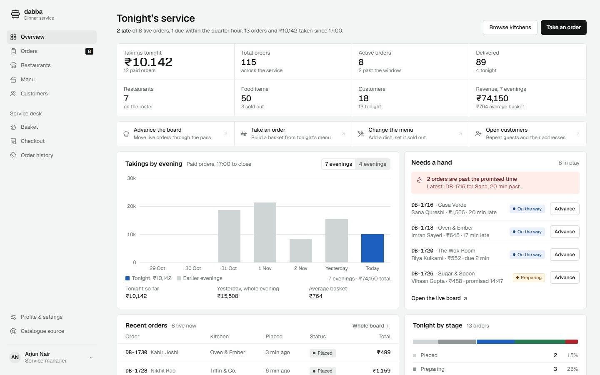

# Dabba — food delivery management system

Dabba is a dinner-delivery service console. One signed-in manager runs the evening: the live order
board, the restaurant roster, the menu, the basket and checkout, order tracking, customers, coupons and
payments, and the full order ledger. It is built with React 19, Vite, Tailwind CSS v4, Context API,
React Router, react-hook-form, react-toastify and localStorage, and it reads its dishes and photographs
from the [DummyJSON recipes API](https://dummyjson.com/docs/recipes).



## Run it

```bash
pnpm install
pnpm dev          # http://localhost:5173
pnpm build        # type-check + production build into dist/
pnpm preview      # serve the production build
pnpm lint         # oxlint over the source
```

The demo manager account is filled in on the sign-in screen, or use it directly:

| Email | Password |
| --- | --- |
| `arjun@dabba.test` | `dabba1234` |

`?demo=1` on any screen signs that account in automatically, for share links and screenshots.

## Modules

| Module | Where | What works |
| --- | --- | --- |
| Authentication | `/login`, `/register`, `/forgot-password` | Validated forms, show/hide password, live password strength, hashed credentials, session in local or tab storage, protected routes, sign-out |
| Dashboard | `/` | Takings for seven evenings, tonight's KPIs, the live board, kitchen load, the sell-out timeline, order stages and quick actions |
| Restaurants | `/restaurants`, `/restaurants/:slug` | The API catalogue grouped into kitchens, derived ratings, live open/closed state, dish search and filters, add to basket |
| Menu management | `/menu`, `/menu/:dishId` | Search, category, veg/non-veg, availability and sort; add a dish, edit it, mark it sold out (with the time), remove it |
| Basket | `/cart` | Add, remove, change quantity, clear, coupons with real arithmetic, totals, localStorage |
| Checkout | `/checkout`, `/checkout/payment` | Saved or new address, contact details, order summary, empty-basket guard, card / UPI / wallet payment, declined and success paths |
| Order tracking | `/orders`, `/orders/:id` | Stage timeline with timestamps, advance a stage, cancel with a refund, rider contact, receipt |
| Profile | `/profile` | Edit name, phone and email; add, edit and delete addresses; wallet; change password; sign out |
| Coupons & payment | `/cart`, `/checkout/payment` | `DINNER50`, `FRESH15`, `FREEBIKE`, discount and GST arithmetic, three payment methods |
| Order history | `/order-history` | Receipt per order, search, status / kitchen / period filters, paging, reorder link, invoice view |

## Project structure

```
src/
  assets/       self-hosted Geist, bundled dish photographs, the credited dabbawala photograph
  components/   brand, cart, catalog, dashboard, layout, menu, orders and ui building blocks
  context/      Auth, Catalog, Orders and Cart providers
  data/         kitchens, prices, customers, the seeded evening, the bundled API snapshot
  hooks/        useAuth / useCart / useCatalog / useOrders, the chart bridge, document titles
  lib/          API client, pricing and coupons, analytics, formatting, storage, SVG charts
  pages/        one folder per module
  routes/       the protected and public-only route guards
```

## Data honesty

- Restaurants, dishes, ingredients, photographs and ratings come from DummyJSON. A bundled snapshot is
  used when the API is unreachable, and the screen says so.
- Kitchens, addresses, customers, riders, coupons, the wallet and the seeded evening are sample data.
- Every total is the sum of the lines shown: subtotal, discount, delivery, packaging and 5% GST.
- The seeded service board is rebuilt each day and re-anchored as the clock moves, so "late" is computed
  from the promised times rather than written into a label. Orders you place or advance are kept.
- Passwords are hashed with SHA-256 before storage. No real payment is taken and no card data leaves the
  tab.

## Design

The interface follows the "achromatic ledger" direction: a steel ground drawn from the tiffin carrier,
white panels, near-black chrome, and one chart hue on the data that answers the screen's question. The
mark is a three-tier tiffin, and the order tracker uses the same stack. Type is Geist, with Geist Mono
for order IDs only. Screens are built from a small set of primitives, so hover, focus, loading, empty and
error states share one language.

## Credits

- Dish photographs and base recipes: [DummyJSON](https://dummyjson.com/docs/recipes).
- "Dabbawala" by Joe Zachs, CC BY 2.0, via [Wikimedia Commons](https://commons.wikimedia.org/wiki/File:Dabbawala.jpg).
- Geist and Geist Mono by Basement Studio and Vercel, SIL Open Font License, self-hosted.
- Icons: [Lucide](https://lucide.dev), ISC.
